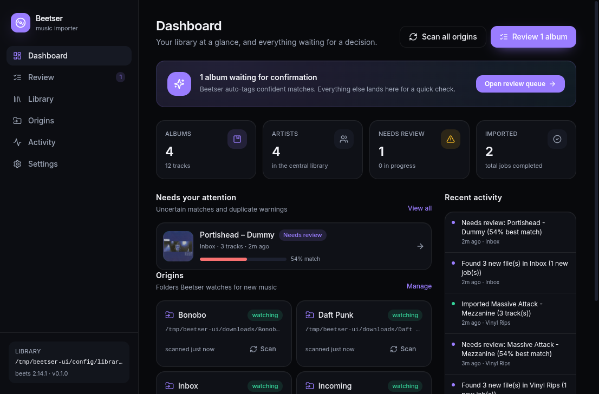
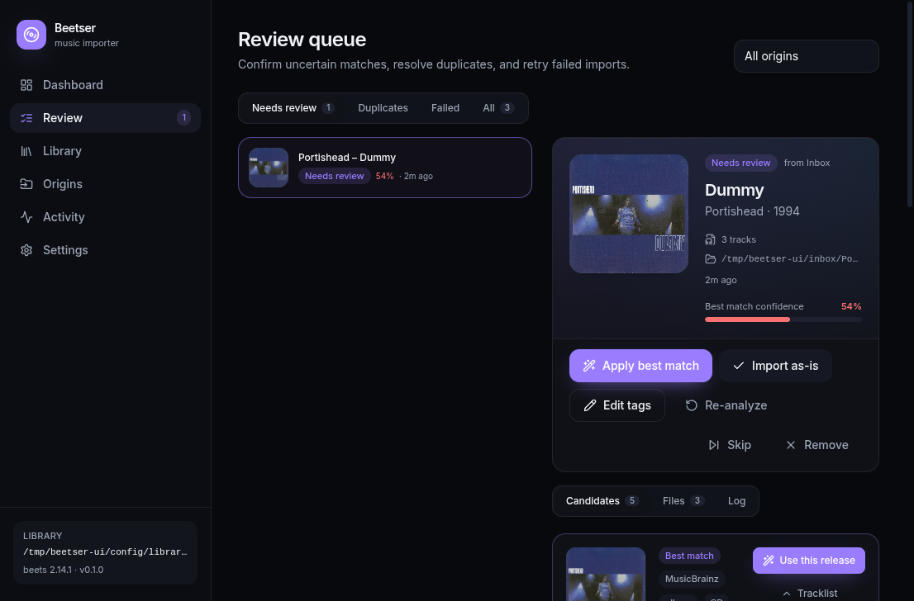

# Beetser

**A modern, self-hosted frontend and automation layer for [beets](https://beets.io).**

Point Beetser at the folders where music lands (download clients, Syncthing,
SMB shares, ripped CDs…) and it will watch them, group new files into albums,
tag them with MusicBrainz, route uncertain matches to a review queue, and keep
one central library — while every origin keeps its own files and its own
destination.



## Why

beets is excellent at tagging and organizing music, but it is a CLI. Beetser
adds the parts that make it a comfortable always-on service:

- **Multiple watched origins** — one per download client, share or workflow.
- **Automatic album detection** — new folders are grouped, analysed and either
  auto-imported or queued for review.
- **A real review queue** — compare MusicBrainz candidates, inspect track
  mappings, edit tags by hand, import as-is or skip.
- **Duplicate protection** — content hashes, release MBIDs and track matching
  before anything is added twice. Override with one click when it is a remaster.
- **One central beets database** — every origin contributes to the same library.
- **Per-origin policy** — move or copy, custom destination, custom path format,
  auto-tag on/off and per-origin confidence threshold.
- **Modern UI** — dark/light, live updates, searchable library, activity log and
  optional webhook notifications.

## Features at a glance

| Area | What you get |
| --- | --- |
| Origins | Unlimited watched folders, inotify + periodic scanning, settle time, `.beetser-ignore` markers |
| Tagging | MusicBrainz lookups in-process, candidate comparison, manual tag editor, no API keys required |
| Imports | Move or copy, per-origin destination, beets path formats, tag writing, local cover adoption, cover art fetch/embed |
| Safety | SHA-256 dedupe, MBID dedupe, album/track matching, duplicate confirmation dialog |
| Operations | Live activity log, job states, retries, skip/forget, single-admin auth, health endpoint |
| Deployment | One container, SQLite, no external services, TrueNAS-friendly |

## Quick start

```bash
git clone https://github.com/beetser/beetser.git
cd beetser
cp .env.example .env          # optional
docker compose up -d --build
```

Open <http://localhost:8080>. On first launch you can create the admin password
in the UI (or set `BEETSER_PASSWORD` in the environment).

Then:

1. **Origins → Add origin** and pick the folder where music arrives, e.g.
   `/media/downloads`.
2. Leave *Organize inside the origin folder* enabled to sort files in place, or
   choose a separate destination such as `/media/music`.
3. Drop an album folder into the origin. Beetser scans it, shows the best match
   and either imports it or asks you to confirm.

> The container must be able to see your media paths. Mount each host folder at
> its own container path (see
> [`docker-compose.multi-media.yml`](docker-compose.multi-media.yml)) or mount a
> single parent at `/media`; then use those container paths as origins.

## How it works

```
origin folders ──► watcher + periodic scan ──► album grouping
                                                │
                                       MusicBrainz + duplicate checks
                                                │
                         ┌──────────────────────┴──────────────────────┐
                         ▼                                             ▼
                 confident match                                 needs review
                         │                                             │
                    beets import                               UI: choose / edit
                         │                                             │
                         └──────────────► central beets DB ◄───────────┘
```

- The beets library database lives in `/config/library.db` and is shared by
  every origin.
- Each origin has its own destination. When the destination is the origin
  itself, imports are reorganized in place (artist/album folders).
- Imports run through the beets importer in a subprocess so a bad file cannot
  take down the API, and so the central library stays consistent.
- Beetser stores item paths as absolute paths in the beets database, which is
  what makes a central library with many destination roots reliable.

More detail: [docs/ARCHITECTURE.md](docs/ARCHITECTURE.md).

## Documentation

- [Architecture](docs/ARCHITECTURE.md) — components, data model, state machine, duplicate strategy.
- [Configuration](docs/CONFIGURATION.md) — environment variables, global settings, per-origin overrides, path formats, webhooks.
- [TrueNAS SCALE](docs/TRUENAS.md) — custom app install, datasets, permissions, catalog chart scaffold.
- API reference — served by the app at `/api/docs`.

## Configuration highlights

Global defaults live in **Settings**:

- default import mode (`move`/`copy`), path formats for albums, compilations and singles;
- auto-tagging on/off, confidence threshold, ambiguity gap;
- cover art fetch/embed;
- settle time and full-scan interval;
- notification webhook and per-event toggles.

Every origin can override the import mode, destination, path formats, auto-tag
mode and threshold. See [docs/CONFIGURATION.md](docs/CONFIGURATION.md).

## Review queue



Each job shows the proposed release, the confidence, the track mapping and the
current tags. Actions:

- **Apply best match** — import using the top MusicBrainz release.
- **Use this release** — force a specific candidate.
- **Import as-is** — keep existing tags, adopt a local `cover`/`folder` image, and still organize into the destination.
- **Edit tags** — write album-level fields and per-track titles, then import.
- **Re-analyze** — retry the lookup (useful after network hiccups).
- **Skip / Remove** — keep files untouched, or forget the job so it can be rediscovered.

Duplicate jobs require an explicit **Import anyway** confirmation.

## Editing the library

Open any album and choose **Edit album** to change its metadata, artwork and
track titles after import. Artwork can be uploaded, downloaded from the Cover
Art Archive, or removed. Saves can write tags into the audio files and move
files to the new artist/album paths, so the library and the filesystem stay in
sync.

## Deployment

- Single container, port `8080`.
- `/config` holds the library database, Beetser state, generated beets configs,
  logs and the session secret. Back it up.
- Media paths are whatever you mount; nothing is assumed.
- Health check: `GET /api/system/health`.
- Graceful shutdown drains the worker; jobs interrupted by a restart are marked
  failed and can be retried.

### TrueNAS SCALE

Use the ready-made Compose file in [`truenas/custom-app.yaml`](truenas/custom-app.yaml)
or follow [docs/TRUENAS.md](docs/TRUENAS.md). A catalog chart scaffold lives in
[`truenas/catalog/ix-dev/stable/beetser`](truenas/catalog/ix-dev/stable/beetser).

## Development

Requirements: Python 3.11+, Node 20+, ffmpeg (for tests), a MusicBrainz-reachable network.

```bash
# Backend
python -m venv .venv
.venv/bin/pip install -e "backend[dev]"
.venv/bin/python -m beetser          # http://localhost:8080

# Frontend (Vite dev server proxies /api to :8080)
cd frontend
npm install
npm run dev

# Tests and type checks
cd backend && ../.venv/bin/python -m pytest
cd frontend && npm run typecheck && npm run build
```

The backend tests generate real FLAC files with ffmpeg and run the beets
importer, but never call MusicBrainz (lookups are stubbed), so they work offline.

### Project layout

```
backend/beetser/     FastAPI app, worker, scanner, beets integration
backend/tests/       pytest suite (API, scanner, import, dedupe)
frontend/src/        React + TypeScript + Tailwind UI
docker/              entrypoint
truenas/             custom app compose + catalog chart scaffold
docs/                architecture, configuration, TrueNAS guide
```

## Security

- Single admin account with a scrypt-hashed password and signed, HttpOnly session cookies.
- Login throttling after repeated failures.
- The app is intended for a trusted network or behind a reverse proxy; terminate
  TLS at the proxy (Secure cookies are enabled automatically when
  `X-Forwarded-Proto: https` is present).
- The webhook URL is only configurable by the authenticated admin.

## Status

This is an early release (`0.1.0`). The API and database schema may change
before `1.0`. Issues and pull requests are welcome.

## License

No license has been chosen yet. Add one before distributing the project.
